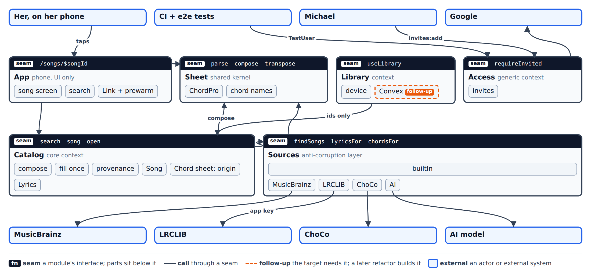
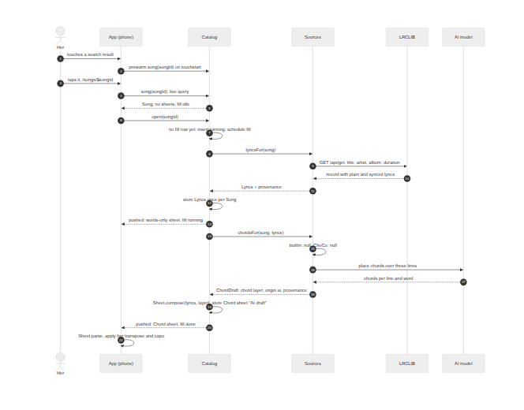
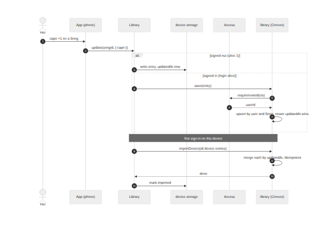
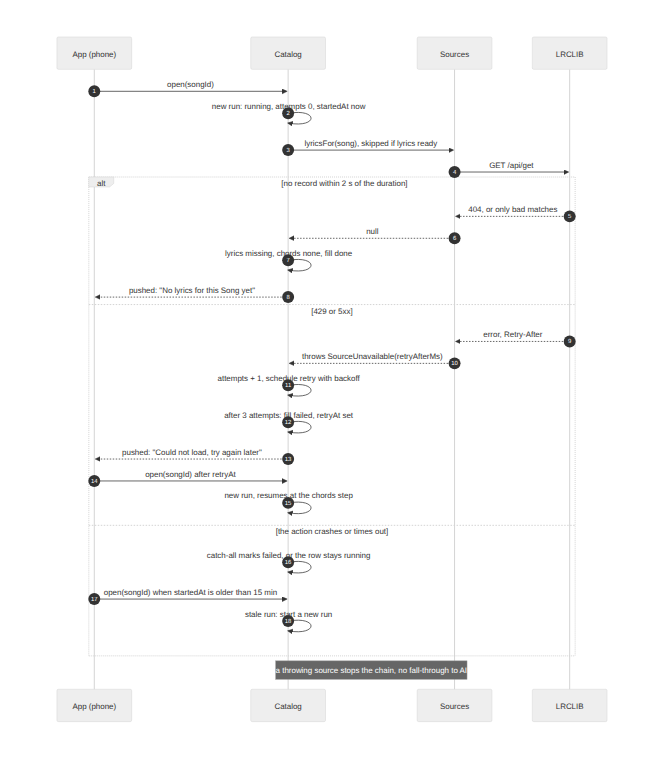

# OpenChords architecture

**Question.** How should OpenChords be shaped across Convex and the PWA? That covers the data model for Songs, Chord sheets and her Library, where the song sources plug in, how links preload, how invites gate it, and how offline works later.

**Answer, in one paragraph.** OpenChords is four small bounded contexts around one shared kernel, and they refer to each other only by id. **Catalog**, the core context, owns what a Song is: the Song, its Lyrics and its Chord sheets, each with its provenance. **Sources** is Catalog's anti-corruption layer: it turns MusicBrainz, LRCLIB, ChoCo and the AI model into Catalog's words and keeps their models out. **Library** owns what one person chose. **Access** owns who may come in. **Sheet** is the shared music-theory kernel, pure TypeScript used by both the server and the phone. App is UI only. We decide now what is expensive to change later (ids, provenance, the Chord sheet version rule), and we defer what is cheap to add later (events, components, revisions).

Decided in [Silthus/personal#254](https://github.com/Silthus/personal/issues/254) over three grilling rounds. Every decision is listed under [Decisions](#decisions).

## Rung 1 and 2: the context map



The page itself is [`openchords/modules.html`](openchords/modules.html), generated from [`openchords/modules.json`](openchords/modules.json).

| Context | Kind | Owns | Public interface | Lives in |
| --- | --- | --- | --- | --- |
| Catalog | core | Song, Lyrics, Chord sheet, the fill | `search`, `song`, `open` | `convex/catalog/` |
| Sources | anti-corruption layer | adapters to outside systems | `findSongs`, `lyricsFor`, `chordsFor` | `convex/sources/` |
| Library | supporting | Library entries for one person | `useLibrary`, `useLibraryEntry` (phone), `library.*` (Convex, login slice) | `src/library/`, `convex/library/` |
| Access | generic | users, invites | `requireInvited`, `access/invites:add` | `convex/access/` |
| Sheet | shared kernel | chords, keys, capo, transpose, ChordPro | `parse`, `compose`, `transpose`, `shapes` | `src/sheet/` |
| App | UI, not a context | routes, screens, prewarm links | routes | `src/app/` |

### Relations

- **App → Catalog, Library, Sheet.** It calls their interfaces and holds no domain rules.
- **Catalog → Sources.** Catalog is downstream. Sources translates every outside model into Catalog's types, so no MusicBrainz, LRCLIB, ChoCo or AI shape crosses the seam.
- **Catalog → Sheet.** Catalog composes the stored ChordPro with `Sheet.compose`. The phone parses it with `Sheet.parse`. Both sides import the same code.
- **Sources → Sheet.** Types and validation only: a `ChordDraft` carries a `ChordLayer`, and the AI adapter validates its output against it.
- **Library → Catalog.** By id only: a Library entry stores a `SongId` and a `ChordSheetId`, and never reads Catalog's tables.
- **Access → all.** Other contexts see a `UserId` and call `requireInvited`. Nothing else about users leaks.

### Rules between contexts

1. A context is a folder with one public file (`index.ts`). One lint rule (`no-restricted-imports` on `convex/*/!(index)`, `src/sheet/*/!(index)` and `src/library/*/!(index)` from outside) forbids deep imports.
2. Contexts reference each other by id only and never read another context's tables.
3. There are no events, no bus and no Convex component per context. Library components such as `@convex-dev/static-hosting` and `@convex-dev/rate-limiter` are fine. A context calls another's interface directly. Convex's reactive queries cover "tell me when it changed".
4. Every piece of stored content (Lyrics, Chord sheet) carries **provenance**: source, record id at the source, licence tag, fetch time.

### Not doing now

Domain events, Convex components per context, repository layers over `ctx.db`, CQRS, a plugin system, and workspaces or packages per context. Each is listed with its trigger under [Follow-ups](#follow-ups).

## Data model

All tables are Convex tables. Each context's `schema.ts` exports its tables, and `convex/schema.ts` merges them. Nothing stores lyrics outside Catalog.

```ts
// convex/catalog/schema.ts
songs: defineTable({
  title: v.string(),
  artist: v.string(),
  album: v.optional(v.string()),
  durationSec: v.optional(v.number()),
  identityKey: v.string(),                      // normalised "artist|title": one Song per work, not per recording
  musicbrainzIds: v.array(v.string()),           // every recording MBID merged into this Song
  builtInId: v.optional(v.string()),
  searchText: v.string(),                       // "title artist", lowercased
  takenDownAt: v.optional(v.number()),          // set by takedown: open refuses to refill
})
  .index("by_identity", ["identityKey"])
  .index("by_builtIn", ["builtInId"])
  .searchIndex("search", { searchField: "searchText" }),

lyrics: defineTable({                            // at most one per Song
  songId: v.id("songs"),
  lines: v.array(v.string()),                    // plain lyrics, one entry per line
  synced: v.optional(v.array(v.object({ timeMs: v.number(), line: v.number() }))),
  provenance,
}).index("by_song", ["songId"]),

chordSheets: defineTable({                       // immutable once written
  songId: v.id("songs"),
  name: v.string(),                              // "Built in", "ChoCo", "AI draft", later "Her version"
  origin: v.union(v.literal("builtIn"), v.literal("choco"), v.literal("ai"), v.literal("person")),
  chordPro: v.string(),                          // composed by Catalog, words and chords
  lyricsId: v.id("lyrics"),
  provenance,
  createdAt: v.number(),
}).index("by_song", ["songId"]),

fills: defineTable({                             // one per Song, the fill state machine
  songId: v.id("songs"),
  state: v.union(v.literal("running"), v.literal("done"), v.literal("failed")),
  lyrics: v.union(v.literal("pending"), v.literal("ready"), v.literal("missing")),
  chords: v.union(v.literal("pending"), v.literal("ready"), v.literal("none")),
  attempts: v.number(),                          // transient failures in the current run
  startedAt: v.number(),                         // a running fill older than 15 min is stale
  retryAt: v.optional(v.number()),
  error: v.optional(v.string()),
}).index("by_song", ["songId"]),

// shared validator
const provenance = v.object({
  source: v.union(v.literal("builtIn"), v.literal("musicbrainz"), v.literal("lrclib"), v.literal("choco"), v.literal("ai"), v.literal("person")),
  recordId: v.string(),                          // LRCLIB id, ChoCo JAMS path, AI model id + prompt version, UserId
  licence: v.string(),                           // "public-domain", "lrclib-api", "cc-by-4.0", "ai-generated"
  fetchedAt: v.number(),
});

// convex/library/schema.ts (login slice)
libraryEntries: defineTable({
  userId: v.id("users"),
  songId: v.id("songs"),
  chordSheetId: v.optional(v.id("chordSheets")),
  transpose: v.number(),
  capo: v.number(),
  speed: v.number(),
  saved: v.boolean(),
  updatedAt: v.number(),
})
  .index("by_user_song", ["userId", "songId"])
  .index("by_user_saved", ["userId", "saved"]),

// convex/access/schema.ts (login slice)
...authTables,
invites: defineTable({ email: v.string(), invitedAt: v.number() }).index("by_email", ["email"]),
```

**Stored versus fetched or generated.**

- **Stored:** Song info (from search), Lyrics (once per Song, on first open), Chord sheets (composed on first open), and the fill state.
- **Generated on demand, never stored:** the words-only sheet shown while chords are pending, the transposed or capo'd view, and chord diagrams (looked up from the vendored chords-db by Sheet).
- **Fetched on every call:** nothing. After the first open, a Song costs no outside call.

## Rung 3: call paths

### Main read: opening a Song for the first time



Source: [`openchords/open-song.mmd`](openchords/open-song.mmd).

- **App** knows the `SongId` from the search result and nothing about sources.
- **Catalog** knows whether a fill exists. `open` runs in a mutation, so two phones that open the same Song at once insert one `fills` row: Convex's optimistic concurrency retries the second one, and the retry sees the row.
- **Sources** knows the adapter order. It does not know what Catalog stores.
- The words appear as soon as Lyrics are stored. `song` composes a words-only view with `Sheet.compose(lines, null)`, and the Chord sheet follows when `chordsFor` answers.

### Main write: changing a setting, and the first sign-in



Source: [`openchords/library-write.mmd`](openchords/library-write.mmd).

- Slice 1 writes to device storage only (`localStorage` key `openchords.library.v1`).
- The login slice adds the Convex adapter. When a device signs in and has not imported yet, `importDevice` merges each of its entries by `updatedAt`, and the device marks itself imported in its own storage. The merge is per entry and idempotent, so a second device that signs in later merges its entries the same way, and a repeated import changes nothing.

### Most important failure: the fill fails



Source: [`openchords/fill-failure.mmd`](openchords/fill-failure.mmd).

- **No match** (no LRCLIB record within 2 seconds of the Song's duration): `lyrics: "missing"`, `chords: "none"`, the fill is `done` and no Chord sheet is written. The screen says so. AI drafting never runs without lyrics.
- **Transient error** (429, 5xx, timeout): Sources throws `SourceUnavailable`. The fill schedules itself again with backoff, honouring `Retry-After`, up to 3 attempts in one run. After that the fill is `failed` with a `retryAt`, and the next `open` after `retryAt` starts a new run with `attempts` reset to 0.
- **A run resumes, never repeats.** A new run skips `lyricsFor` when `lyrics` is already `ready`, so LRCLIB is still called once per Song, and only the chords step runs again.
- **A throwing source stops its chain.** If ChoCo is down, Sources does not fall through to the AI. Otherwise an outage would replace good chords with drafts for good.
- **The AI cannot place chords:** the AI adapter retries once inside Sources, then returns `null`. The fill is `done` with `chords: "none"`: no retry loop, no repeated AI cost, and the words-only view stays with "No chords yet". A new model or prompt version can refill these Songs later on purpose.
- **The fill crashes** (a bug, the action time limit, a redeploy mid-call): the fill action wraps `fillSong` in a catch-all that marks the row `failed` with the error and `retryAt` one hour later. Convex never retries a scheduled action, so a crash that skips the catch, such as a timeout, leaves the row `running`. `open` treats a `running` row whose `startedAt` is older than 15 minutes as stale and starts a new run, so no Song spins forever.
- **Taken down:** a Song with `takenDownAt` never refills, and `song` returns it without Lyrics or Chord sheets.

## Rung 4: contracts

### Sheet (shared kernel), `src/sheet/index.ts`

```ts
export type Notation = "international" | "german";
export type Chord = { root: PitchClass; quality: string; bass?: PitchClass; written: string };

/** Chords placed over lyric lines by word. `lyricLine: null` is a chord-only line (intro, instrumental). */
export type ChordLayer = {
  key?: string;
  capo: number;                                 // 0..11, the capo the chords are written for
  notation: Notation;
  sections: Array<{ label: string; fromLine: number }>;
  lines: Array<{ lyricLine: number | null; chords: Array<{ word: number; chord: string }> }>;
};

export type ParsedSheet = { meta: SheetMeta; sections: ParsedSection[]; chordsUsed: Chord[] };

export function compose(lyrics: readonly string[], layer: ChordLayer | null, meta: SheetMeta): ChordPro;
export function parse(sheet: ChordPro): ParsedSheet;
export function transpose(chord: Chord, semitones: number): Chord;
export function shapes(sheet: ParsedSheet, view: { transpose: number; capo: number }): ParsedSheet;
export function easierCapo(sheet: ParsedSheet): number | null;   // capo 0..7, fewest barre chords
```

- **Invariants.** Every function is pure, with no Convex, DOM or network imports, and runs the same on server and phone. `parse(compose(l, layer, m))` returns every lyric line of `l` in order. Chords keep their written text, so German `H` stays `H`. `transpose` rewrites only the root and the bass.
- **Error modes.** `parse` never throws: an unknown bracket becomes an annotation. `compose` throws `InvalidChordLayer` when a placement points past a line's words or past the lyrics, and Catalog treats that as a failed chord draft.
- **Performance.** Linear in sheet size. A typical Song of 60 lines parses in under 1 ms on a phone.

### Sources (anti-corruption layer), `convex/sources/index.ts`

```ts
export type Provenance = { source: SourceName; recordId: string; licence: string; fetchedAt: number };
export type SongHit = {
  title: string; artist: string; album?: string; durationSec?: number;
  identityKey: string;                     // normalised "artist|title"
  musicbrainzIds: string[];                // every recording of this work in the answer
  builtInId?: string;
};
export type Lyrics = { lines: string[]; synced?: Array<{ timeMs: number; line: number }>; provenance: Provenance };
export type ChordDraft = { layer: ChordLayer; origin: "builtIn" | "choco" | "ai"; provenance: Provenance };

export class SourceUnavailable extends Error { constructor(readonly retryAfterMs: number) { super() } }

export interface Sources {
  findSongs(query: string): Promise<SongHit[]>;
  lyricsFor(song: SongHit): Promise<Lyrics | null>;
  chordsFor(song: SongHit, lyrics: Lyrics): Promise<ChordDraft | null>;
}

export function sourcesFor(env: SourcesEnv): Sources;   // adapters chosen by OPENCHORDS_SOURCES
```

- **Order.** `findSongs` tries builtIn, then MusicBrainz. The MusicBrainz adapter folds recordings of the same work (same normalised artist and title) into one hit, keeps every recording MBID, and takes the duration that most recordings share, so a remaster or a live take never becomes a second Song. `lyricsFor` tries builtIn, then LRCLIB. `chordsFor` tries builtIn, then ChoCo, then AI. For lyrics and chords, the first non-null answer wins.
- **Configuration.** `OPENCHORDS_SOURCES` lists the enabled adapters: `builtIn` for slice 1 and for every preview, `builtIn,musicbrainz,lrclib,choco,ai` on dev and production once real songs land, and `fake` in tests.
- **Outside sources require invites.** `sourcesFor` throws at load when any outside adapter (`musicbrainz`, `lrclib`, `choco`, `ai`) is enabled and `OPENCHORDS_INVITES` is not `on`. So the real-songs slice cannot ship before the login slice, and nobody on a public URL can trigger LRCLIB, MusicBrainz or AI calls.
- **Secrets.** `LRCLIB_APP_ID`, `LRCLIB_API_KEY` and the AI credentials live only in Convex environment variables on the dev and production deployments, never as preview defaults, never in the repo or CI logs.
- **Invariants.**
  - No outside model crosses the seam.
  - Every answer carries provenance.
  - `null` means "this source has nothing". A throw means "try later", and stops the chain.
  - LRCLIB matching picks by title, artist and duration within 2 seconds, never the first hit.
  - The AI adapter receives only the lines it must place chords over, and its output is validated against `ChordLayer` before it returns.
- **Error modes.** `SourceUnavailable(retryAfterMs)` for 429, 5xx and timeouts. An AI output that still fails validation after one retry is `null`, not an error. Anything else is a bug and throws as-is, and the fill's catch-all records it.
- **Performance.**
  - MusicBrainz: at most 1 request per second app-wide, through the `@convex-dev/rate-limiter` component. When the limit is hit, `findSongs` returns builtIn hits only, so search never waits.
  - LRCLIB: one request per Song, ever. A registered server-side app sends `Lrclib-App-Id` and `Lrclib-Api-Key` and gets an app-wide allowance of about 6,000 requests per minute ([LRCLIB docs, "Client identification"](https://lrclib.net/docs.md)), far above the anonymous 90 per minute per IP.
  - AI: 5 to 30 seconds per Song.

### Catalog (core context), `convex/catalog/index.ts`

```ts
export const search = action({
  args: { query: v.string() },                      // 2..100 chars
  returns: v.array(songSummary),                    // { songId, title, artist, durationSec, hasSheets }
});

export const song = query({
  args: { songId: v.id("songs") },
  returns: v.union(v.null(), v.object({
    song: songSummary,
    sheets: v.array(v.object({
      chordSheetId: v.union(v.id("chordSheets"), v.null()),  // null: the words-only view
      name: v.string(), origin: originValidator, chordPro: v.string(),
    })),
    lyrics: v.union(v.literal("pending"), v.literal("ready"), v.literal("missing")),
    chords: v.union(v.literal("pending"), v.literal("ready"), v.literal("none")),
    fill: v.union(v.literal("idle"), v.literal("running"), v.literal("done"), v.literal("failed")),
    retryAt: v.optional(v.number()),
  })),
});

export const open = mutation({ args: { songId: v.id("songs") }, returns: v.null() });

// convex/catalog/takedown.ts, run by hand: bunx convex run catalog/takedown:song
export const song = internalMutation({ args: { songId: v.id("songs") }, returns: v.null() });
```

- **`search`** queries Catalog's own `search` index first, then `Sources.findSongs`. It upserts each hit into `songs` by `identityKey`, adding new recording MBIDs to `musicbrainzIds`, so every result has a `SongId` that a link can prewarm and each work is one Song.
- **`song`** never calls Sources and never writes. It returns stored Chord sheets in creation order. When Lyrics are ready but no Chord sheet exists yet, it returns one words-only view composed on the fly.
- **`open`** is idempotent. It starts a run (`state: "running"`, `attempts: 0`, `startedAt: now`) and schedules `internal.catalog.fill` in three cases: no row exists, the row is `failed` and `retryAt` has passed, or the row is `running` with `startedAt` older than 15 minutes. Otherwise, and always for a taken-down Song, it does nothing.
- **The fill** (`internal.catalog.fill`, an action) skips `lyricsFor` when `lyrics` is `ready`. Otherwise it runs `lyricsFor` and stores the Lyrics. Then it runs `chordsFor`, composes with `Sheet.compose` and stores the Chord sheet. Every step writes through an internal mutation that first checks the run's `startedAt`, so a stale run that wakes up late cannot overwrite a newer one. Its logic is `fillSong(ctx, songId, sources)`, and the action passes `sourcesFor(env)`. A catch-all around it records any throw as `failed`.
- **Takedown** deletes the Song's Lyrics, every Chord sheet and the fill row, and sets `takenDownAt`, because every stored ChordPro also contains the words. Library entries that point at a deleted Chord sheet fall back by rule, and phones drop their offline copy at the next sync.
- **Invariants.**
  - At most one Lyrics record per Song.
  - Chord sheets are immutable: a fix becomes a new Chord sheet with `origin: "person"`, in the fix-a-chord slice.
  - Only Catalog writes `songs`, `lyrics`, `chordSheets` and `fills`.
  - One Song per work: `identityKey` is unique.
- **Error modes.** `song` returns `null` for an unknown id. `open` on an unknown id throws `ConvexError({ code: "NOT_FOUND" })`. From the login slice on, all three call `requireInvited` first.
- **Performance.** `song` reads 3 indexed documents plus the Chord sheets, and is cheap enough to prewarm on every hover or touch. `search` costs one index query plus at most one MusicBrainz call.

### Library, `src/library/` and `convex/library/`

```ts
export type LibraryEntry = {
  songId: Id<"songs">; chordSheetId?: Id<"chordSheets">;
  transpose: number; capo: number; speed: number; saved: boolean; updatedAt: number;
};
export function useLibraryEntry(songId: Id<"songs">): [LibraryEntry | undefined, (patch: Partial<LibraryEntry>) => void];
export function useLibrary(): { saved: LibraryEntry[] };

// login slice, Convex
export const entries = query({ returns: v.array(libraryEntry) });
export const save = mutation({ args: { entry: libraryEntry }, returns: v.null() });
export const importDevice = mutation({ args: { entries: v.array(libraryEntry) }, returns: v.null() });
export function mergeEntries(a: LibraryEntry, b: LibraryEntry): LibraryEntry;   // pure, in src/library/, imported by convex/library/
```

- **Invariants.** One entry per person and Song. `updatedAt` comes from the writing device's clock, and the newer value wins. `importDevice` is idempotent and runs once per device, not once per person. A `chordSheetId` that no longer exists falls back to the Song's first Chord sheet. Text size and theme are app-wide settings, not Library entries.
- **Error modes.** The device adapter never throws: when storage is full or blocked, it keeps the entry in memory for the session. The Convex adapter queues writes while offline, as the Convex client already does.
- **Performance.** Every write is local first. A transpose tap never waits for the network.

### Access, `convex/access/index.ts`

```ts
export async function requireInvited(ctx: QueryCtx | MutationCtx | ActionCtx): Promise<Id<"users">>;
// throws ConvexError({ code: "NOT_SIGNED_IN" }) or ConvexError({ code: "NOT_INVITED" })

// convex/access/invites.ts
export const add = internalMutation({ args: { email: v.string() }, returns: v.null() });   // bunx convex run access/invites:add
```

- **Sign-in.** Convex Auth with Google. `afterUserCreatedOrUpdated` throws `NOT_INVITED` when the verified, lowercased email has no invite, so no session is created.
- **Every function.** When `OPENCHORDS_INVITES=on`, every public Catalog and Library function calls `requireInvited` first. A guard test enumerates the public functions and fails when one skips it. The login slice sets the flag on every deployment. Slice 1 runs without it, holding only public-domain songs, and Sources refuses outside adapters while it is off.
- **TestUser.** A `ConvexCredentials` provider (`id: "test-user"`), registered only when `OPENCHORDS_ALLOW_TEST_SIGNIN=1`. `OPENCHORDS_ENV` is `production` on the production deployment only, and the auth module throws at load when both are set, as Lonir's `auth/provider.ts:10` does. Test emails end in `@test.openchords.invalid`, and the invite check accepts that domain only while TestUser is registered, so tests need no seeded invites (ADR-0004).
- **Uninvited visitor on a shared link.** Signed out: a sign-in screen that keeps the target path. Signed in but not invited: "OpenChords is invite-only. Ask the person who shared this link."

### Routes and preloading, `src/app/routes/`

| Route | Shows | Prewarms |
| --- | --- | --- |
| `/` | search | none |
| `/songs/$songId` | the Song with her Library pick, or its first Chord sheet | `catalog.song` |
| `/songs/$songId/sheets/$chordSheetId` | that exact Chord sheet, for sharing a version | `catalog.song` |

- **Pattern.** TanStack Router file routes. Every link goes through one `Link` wrapper (Lonir `packages/data/src/router/Link.tsx`), with `preload="intent"` for the code chunk and `prewarmQuery` for data, through a `*.prewarm.ts` file beside each route.
- **Changes from Lonir.**
  - `onTouchStart` prewarms immediately, with no 120 ms debounce, because a tap follows within about 100 ms on a phone. Mouse and focus keep Lonir's 120 ms debounce, 3 s dedupe and 8 s hold.
  - Lonir only prewarms when signed in (`use-route-prewarm-intent.ts:81`). Here `isEnabled` is always true in slice 1, and follows `isAuthenticated` once `OPENCHORDS_INVITES` is on.
- **Lint.** The rule `no-tanstack-link-import` keeps every link on the wrapper.

### Offline (shape only, built later)

- **Precache:** the app shell with `vite-plugin-pwa` in `prompt` mode. `navigateFallbackDenylist: [/^\/api\//, /^\/\.well-known\//]` keeps Convex Auth's routes off the shell.
- **Kept readable offline:** every saved Library Song, plus the last 20 opened Songs.
- **How:** App writes each `catalog.song` result, which is self-contained, to IndexedDB after it renders, and the route reads IndexedDB when the Convex client is offline. The service worker never caches Convex data.
- **Provenance travels with the cached copy,** so a takedown also clears the copies on the phone at the next sync.

### Previews and tests

- **Preview per PR.** Every PR, drafts included, deploys a Convex preview `pr-<n>` with `CONVEX_PREVIEW_DEPLOY_KEY`, because PRs stay drafts until Michael reviews them and she co-designs before that. Previews run `OPENCHORDS_SOURCES=builtIn` and hold no outside-source secrets.
  1. `bunx convex deploy --preview-name pr-<n> --cmd 'bun run build' --cmd-url-env-var-name VITE_CONVEX_URL`.
  2. Set `SITE_URL` to the preview's `.convex.site` origin.
  3. Upload static hosting with Lonir's admin-credential swap (`packages/backend/scripts/deploy.ts:815-850`), because the upload tool cannot target a preview by name.
  4. Seed the builtIn Songs with `--preview-run`.
  5. Post a sticky PR comment with the `.convex.site` link for her phone.
- **End-to-end tests** run with e2e.tester.army against that preview on every PR, using Michael's ChatGPT login (`e2e login openai --device`), never an API key. They sign in with `TestUser` from the login slice on.
- **Production** deploys on merge to `main` with a production deploy key.

| Seam | Test | Tool |
| --- | --- | --- |
| Sheet | table tests for parse, compose, transpose, German names, `easierCapo` | `bun test` |
| Sources adapters | each adapter against recorded HTTP fixtures, with fetch injected | `bun test` |
| Sources order | `sourcesFor` with fake adapters: null falls through, a throw stops the chain | `bun test` |
| Catalog | `search`, `song`, `open` and the fill, with `OPENCHORDS_SOURCES=fake` | `convex-test` |
| Library | `mergeEntries` as a pure function, hooks with the device adapter | `bun test`, jsdom |
| Access | invite check at sign-in, guard test over every public function | `convex-test` |
| The whole slice | search a builtIn Song, open it, transpose, play | e2e.tester.army on the preview |

### Repo layout

```
src/app/          routes, song screen, search, Library UI
src/sheet/        shared kernel, imported by src/app and convex/
src/library/      Library context on the phone: hooks, device adapter, mergeEntries (imported by convex/library/)
convex/catalog/   index.ts (public), fill.ts, schema.ts
convex/sources/   index.ts (public), builtIn/, musicbrainz/, lrclib/, choco/, ai/
convex/library/   index.ts (public), schema.ts (login slice)
convex/access/    index.ts (public), auth.ts, schema.ts
convex/schema.ts  merges each context's tables
convex/http.ts    auth.addHttpRoutes first, then registerStaticRoutes (app-owned root mode)
```

One Bun package. Workspaces wait until a second app, such as native, needs the kernel.

## Decisions

Every decision below was accepted by Michael on 2026-10-29: either his own answer (👤) or his acceptance of the recommendation (👍).

- 👤 **Lyrics on our server.** Fetched on the server with the LRCLIB app key and cached in our database after the first fetch, so AI can create chords over them.
- 👤 **Catalog is deep.** It looks up Songs and puts lyrics and chords together behind an abstraction that lets sources for both be swapped without changing Catalog's internals.
- 👤 **Sources is its own module**, consumed by Catalog.
- 👤 **DDD, future-proof without overengineering.**
- 👍 **Context map.** Catalog (core), Sources (anti-corruption layer), Library, Access (generic), Sheet (shared kernel), App (UI only).
- 👍 **Ids only between contexts**, one public file per context, a lint rule, no events, no components.
- 👍 **Provenance** on every Lyrics record and Chord sheet.
- 👍 **Chord sheet versions.** Many per Song, each with an `origin`. A fix creates a new Chord sheet. Only `origin` is built now.
- 👍 **Sources interface.** `findSongs`, `lyricsFor` and `chordsFor`, first answer wins, adapters per deployment, fakes in tests. Slice 1 runs builtIn only.
- 👍 **Catalog interface.** `search`, `song` (reactive) and `open` (idempotent fill).
- 👍 **Catalog composes ChordPro.** Chord sources return a chord layer. Order: builtIn, then ChoCo, then AI ("AI draft").
- 👍 **Library before login.** On the device, then Convex, with a per-device merge in which the newer entry wins.
- 👍 **Invites** with `bunx convex run`, checked at sign-in and in every function. Slice 1 runs open.
- 👍 **Previews and tests the Lonir way**, on every PR, with e2e.tester.army and a gated TestUser.
- 👍 **One Bun package**, with folders that follow the contexts.
- 👍 **No component per context** (bold option, rejected).
- 👍 **Prewarm without route loaders**, with `onTouchStart` added.
- 👍 **Catalog in slice 1** through builtIn adapters, not songs bundled into the app.

## Follow-ups

| Follow-up | Trigger | Strength |
| --- | --- | --- |
| Library's Convex adapter and the per-device import | the login slice, which must ship before the real-songs slice | Strong |
| `basedOn` and the fix-a-chord flow | the fix-a-chord slice | Strong |
| Offline module | after the real-songs slice | Worth exploring |
| Domain events between contexts | a second context must react to a change that a reactive query cannot cover | Speculative |
| Convex component per context | a context ships on its own | Speculative |
| Workspaces, with Sheet as a package | a second app needs the kernel | Speculative |
| Licensed lyrics adapter | publishing beyond invite-only | Worth exploring |

## ADRs

- [ADR-0001](../adr/0001-bounded-contexts-as-folders.md): bounded contexts as folders with ids-only references, not components or events.
- [ADR-0002](../adr/0002-lyrics-cached-with-provenance.md): lyrics cached permanently on our server, with provenance on every content row.
- [ADR-0003](../adr/0003-catalog-composes-immutable-chord-sheets.md): sources return chord layers, Catalog composes immutable Chord sheets.
- [ADR-0004](../adr/0004-preview-per-pr-with-test-user.md): a Convex preview per PR, with a TestUser gated off production.
