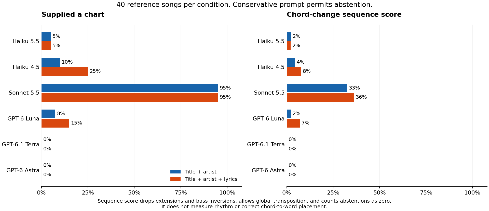

# AI chord drafting from a song title and artist

Research date: 29 October 2026. This is an experiment report, not a production integration. [Public branch and experiment artifacts](https://github.com/Silthus/openchords/tree/research/ai-chords/docs/research/ai-chords).

**Recommendation: do not treat a title-only AI chord chart as a reliable fallback.** A plausible key or a familiar chord loop does not establish the arrangement, its sections, or where changes belong in the words. The experiment distinguishes abstention, chart fidelity, and lyric-anchor validity. It does not establish a musician-verified “playable as is” rate.

The primary run saved **528 outputs**: 480 with section-annotated references and 48 supplementary checks. No referenced output passed the conservative full-chart screen. Sonnet 5.5 supplied 38/40 charts in each condition, with mean reduced, transpose-tolerant sequence agreement of **32.5% blind** and **36.2% with lyrics**. The other configurations mostly abstained. This does not mean that no accompaniment was useful; it means that a verified, complete, correctly aligned sheet was not demonstrated. **For an explicitly unverified prototype, the provisional choice is GPT-6.1 Terra at medium effort with the best-effort prompt.** That choice comes from the smaller exploratory check, not a validated 40-song ranking.



## What was measured

The primary experiment uses **40 distinct songs**, **six models**, and **two input conditions**, with one generation per cell. Four supplementary songs bring the generation set to 44. The two conditions supply title and artist alone, or the same title and artist plus LRCLIB lyrics. Both use the same [fixed prompt](ai-chords/prompt.txt). References, key labels, chord vocabulary, and annotations were never included in a model's prompt. Each invocation ran in a separate temporary directory with no reference files. Tools were disabled in Claude; Codex was instructed to stay closed-book, had web search disabled, and its recorded tool events were checked.

The prompt asks for sounding key, capo, and a bar-by-bar chart in performance order. Chords are fingered shapes relative to the stated capo. It explicitly allows abstention when the model does not know the chart. This tests a conservative fallback policy. It is a demanding request for an entire arrangement, rather than a test of whether a model can name one plausible loop.

A separate, explicitly exploratory [best-effort sensitivity check](ai-chords/sensitivity-selection.json) changes only the abstention instruction. It asks for an approximate chart despite uncertainty. Its six reference songs and two unscored modern songs were selected after observing high abstention in the primary blind run. Its averages must not be pooled with the 40-song results or used to establish a general model ranking.

### References and sample

Every primary song has a McGill Billboard 2.0 expert annotation retrieved from ChoCo at commit `5fe168fd55be5c84512abcfbc4e6f1b1f8f0092a`. The original corpus used two transcribers and a third meta-annotator to reconcile their work. Its release contains chords, sections, and opening tonic labels. These are curated research references, not publisher-endorsed “official guitar charts.” [McGill release and notation guide](https://ddmal.ca/research/The_McGill_Billboard_Project_(Chord_Analysis_Dataset)/), [Burgoyne, Wild and Fujinaga, ISMIR 2011](https://ismir2011.ismir.net/papers/OS8-1.pdf).

The purposeful sample includes country, soul, pop, blues, hard rock and metal repertoire, with artists including Johnny Cash, Anita Baker, Bill Withers, ZZ Top, the Shirelles, Metallica and the Cure. Its chart-slot dates are two songs in the 1950s, 12 in the 1960s, 18 in the 1970s, seven in the 1980s, and one in the 1990s. These are chart dates, not independently verified release dates. It is weighted toward older English-language hits and is not representative of a modern indie catalogue.

There are ten simple, 15 moderate, and 15 complex reference charts by a reproducible **vocabulary-size proxy**: fewer than six, six to 11, or at least 12 distinct annotated chord labels. This is not a measure of fingering difficulty. The [song manifest](ai-chords/songs.json) records each title, artist, source URL, chart date, reference hash, and difficulty bucket. Full selected annotations and extracted JAMS observations are in [references](ai-chords/references/).

The supplementary songs are *Riverside* (Agnes Obel), *I Will Follow You into the Dark* (Death Cab for Cutie), *Down by the Water* (the Decemberists), and *Nothing Else Matters* (Metallica). The first three had no exact reference match in the nine ChoCo metadata partitions inspected. That search is recorded in [reference-search.json](ai-chords/reference-search.json); it is not proof that no licensed reference exists elsewhere. *Nothing Else Matters* has a Wikifonia lead sheet and a corroborating iReal Pro title/artist match. Its lead-sheet vocabulary is evaluated separately because it lacks the named sections needed by the primary metric. A USPop annotation is tied to a live recording and was excluded from the studio-arrangement comparison. [Supplementary reference and limitations](ai-chords/supplementary-reference.json). Two Johnny Cash songs, *I Got Stripes* and *The Ways of a Woman in Love*, are in the primary 40.

### Exact model selections

| Provider CLI | Model ID | Requested effort | Role |
| --- | --- | --- | --- |
| `claude -p` | `claude-haiku-5-5` | medium | Current small model |
| `claude -p` | `claude-haiku-4-5-20251001` | medium | Previous small model |
| `claude -p` | `claude-sonnet-5-5` | high | Larger Claude comparison |
| `codex exec` | `gpt-6-luna` | medium | Efficient OpenAI model |
| `codex exec` | `gpt-6.1-terra` | medium | Second efficient OpenAI model |
| `codex exec` | `gpt-6-astra` | high | Larger OpenAI comparison |

These are model-and-effort configurations, not a parameter-matched model-size experiment. Sonnet is the larger Claude comparator; Opus was not benchmarked. The CLI is not evidence that old Haiku and newer models interpret an effort label identically. The requested Claude IDs were checked against the model-usage keys reported in each completed CLI result. [Official OpenAI documentation](https://learn.chatgpt.com/docs/models) lists the three OpenAI IDs and their positioning. [Anthropic's model documentation](https://platform.claude.com/docs/en/models/overview) returned HTTP 403 during final source verification, so its current model descriptions could not be independently rechecked. CLI versions, invocation settings, and transport limits are recorded in [run-environment.json](ai-chords/run-environment.json).

### Lyrics, versions, and privacy of inputs

Lyrics were fetched locally through LRCLIB. Only IDs, metadata, hashes, and per-line word counts are committed. Prompts and outputs use numeric line/word positions; no lyric words are redistributed. The client identified itself and slowed requests after rate limiting. LRCLIB documents title/artist search, optional duration matching, record lookup, and CORS access. [LRCLIB API documentation](https://lrclib.net/docs.md).

A duration audit found nine initial records corresponding to a substantially different edit or recording. Search results were manually checked for artist identity, and replacement metadata were chosen closer to the annotated durations. Eight replacements had **identical plain lyric text**, so their model inputs did not change. *Wichita Lineman* had different text and its affected lyric generations were rerun. Original inputs and superseded outputs remain identifiable. *I Put a Spell on You* still has an approximately 11-second recording/fade difference, but the corrected studio record's plain lyrics are identical to the initial input. Duration agreement alone does not establish recording identity. [Initial duration audit](ai-chords/lyric-duration-audit-initial.json), [input corrections](ai-chords/lyric-input-corrections.json), [final input manifest](ai-chords/lyrics-manifest.json).

For the application, a lyric-aware remote inference request necessarily sends its lyric input to the inference provider. Returning only numeric positions avoids redistributing words in the result; it does not avoid transmitting the input. If lyrics must stay on the device, a backend that receives or forwards those words is incompatible with that constraint. This CLI experiment does not establish a compliant production architecture.

## Metrics and their limits

- **Opening tonic agreement:** pitch class matches McGill's opening tonic, accepting enharmonic spelling and a tonic stated relative to the provided capo. McGill's header does not reliably establish major/minor mode, so full key accuracy is **not measured**. Tonic agreement includes a known tonic returned with an abstention. It is annotation agreement, not a definitive ruling on musically ambiguous keys.
- **Chord vocabulary:** Jaccard overlap of reference and generated chord sets. Full scoring preserves pitch-class content and bass inversion. A separate reduced score drops extensions and slash basses. German `H/B` is normalized when `H` makes that naming system identifiable; the prompt itself requests international names. Fingered chords are raised by the capo before scoring.
- **Sequence agreement:** one minus Levenshtein distance divided by the longer chord-change sequence. Consecutive repeated identical chords and no-chord spans are removed. Global sequence agreement ignores section names. Section agreement matches the nth occurrence of each normalized section name and penalizes missing and extra occurrences. Aliases such as refrain/chorus and ending/outro are normalized; pre-chorus is grouped with verse. This measures chord-change order, **not rhythm, bar duration, or audio-aligned chord recognition**.
- **Transpose-tolerant diagnostic:** the best global reduced sequence score over all 12 common transpositions. It permits an alternative playing key, but still requires the progression and order to agree. A high score does not prove the stated key/capo metadata is internally consistent.
- **Sections:** counts and order are compared with the reference labels. Differences can reflect annotation conventions as well as hallucinated or omitted material. Section-label discrepancies alone are not treated as proof that a model invented musical content.
- **Lyric anchors:** valid zero-based line/word indices, ordering, duplicate positions, and fraction of nonblank lyric lines covered. These are structural checks. No expert word-level chord-change ground truth was established, so `word_placement_accuracy` is null throughout. Some LRCLIB records provide timing data, but we did not establish a recording-matched, expert-checked chord-to-word alignment from them.
- **“Playable as is”:** every generation has a verdict in the per-song results. A conservative screen requires tonic agreement, at least 80% reduced vocabulary overlap, at least 85% reduced global sequence agreement, exact normalized section order, and, for lyric inputs, at least 90% line coverage with no invalid positions. Passing would still mean **needs musician/audio verification**. Failing means **fails the reference-fidelity screen**, not proof that no simplified accompaniment could be played. No human musician listening trial was conducted.

Main accuracy averages include abstentions and failed generations as zero. Conditional chart-only results are also retained to avoid hiding the difference between supplying few charts and supplying inaccurate charts. Each result is one sample; no repeatability or uncertainty-calibration study was run. The common-transpose and reduced metrics are deliberately forgiving diagnostics, not substitutes for musical verification.

## Results

| Model | Input | Charts | Opening tonic | Full vocab overlap | Reduced vocab | Section sequence | Global sequence | Reduced + transpose sequence |
| --- | --- | --- | --- | --- | --- | --- | --- | --- |
| Haiku 5.5 | blind | 2/40 | 5/40 | 3.6% | 4.0% | 1.7% | 2.2% | 2.2% |
| Haiku 5.5 | lyrics | 2/40 | 4/40 | 3.6% | 4.0% | 1.3% | 2.0% | 2.0% |
| Haiku 4.5 | blind | 4/40 | 4/40 | 4.2% | 5.4% | 1.6% | 2.8% | 4.3% |
| Haiku 4.5 | lyrics | 10/40 | 3/40 | 2.7% | 4.0% | 1.4% | 2.7% | 7.7% |
| Sonnet 5.5 | blind | 38/40 | 14/40 | 16.1% | 29.4% | 6.4% | 11.6% | 32.5% |
| Sonnet 5.5 | lyrics | 38/40 | 13/40 | 14.4% | 26.2% | 7.2% | 13.1% | 36.2% |
| GPT-6 Luna | blind | 3/40 | 4/40 | 1.1% | 3.4% | 0.6% | 0.8% | 2.2% |
| GPT-6 Luna | lyrics | 6/40 | 11/40 | 4.7% | 9.9% | 2.3% | 3.6% | 7.0% |
| GPT-6.1 Terra | blind | 0/40 | 17/40 | 0.0% | 0.0% | 0.0% | 0.0% | 0.0% |
| GPT-6.1 Terra | lyrics | 0/40 | 18/40 | 0.0% | 0.0% | 0.0% | 0.0% | 0.0% |
| GPT-6 Astra | blind | 0/40 | 32/40 | 0.0% | 0.0% | 0.0% | 0.0% | 0.0% |
| GPT-6 Astra | lyrics | 0/40 | 31/40 | 0.0% | 0.0% | 0.0% | 0.0% | 0.0% |

Across-song spread for the reduced, transpose-tolerant diagnostic (abstentions are zero). The final column scores only supplied charts; models supplied different songs, so it is not a matched comparison:

| Model | Input | Median | p10–p90 | Min–max | Mean among supplied charts |
| --- | --- | --- | --- | --- | --- |
| Haiku 5.5 | blind | 0.0% | 0.0%–0.0% | 0.0%–54.7% | 44.3% |
| Haiku 5.5 | lyrics | 0.0% | 0.0%–0.0% | 0.0%–42.7% | 40.9% |
| Haiku 4.5 | blind | 0.0% | 0.0%–0.0% | 0.0%–54.7% | 43.0% |
| Haiku 4.5 | lyrics | 0.0% | 0.0%–30.4% | 0.0%–54.8% | 30.8% |
| Sonnet 5.5 | blind | 31.9% | 5.8%–48.4% | 0.0%–80.0% | 34.2% |
| Sonnet 5.5 | lyrics | 35.5% | 1.2%–58.9% | 0.0%–88.2% | 38.1% |
| GPT-6 Luna | blind | 0.0% | 0.0%–0.0% | 0.0%–55.4% | 29.4% |
| GPT-6 Luna | lyrics | 0.0% | 0.0%–40.3% | 0.0%–70.7% | 46.7% |
| GPT-6.1 Terra | blind | 0.0% | 0.0%–0.0% | 0.0%–0.0% | no charts |
| GPT-6.1 Terra | lyrics | 0.0% | 0.0%–0.0% | 0.0%–0.0% | no charts |
| GPT-6 Astra | blind | 0.0% | 0.0%–0.0% | 0.0%–0.0% | no charts |
| GPT-6 Astra | lyrics | 0.0% | 0.0%–0.0% | 0.0%–0.0% | no charts |

Sonnet's blind reduced, transpose-tolerant scores ranged from 0% to 80.0%; its lyric-aware scores ranged from 0% to 88.2%. Its blind charts differed from reference section counts in 36/38 cases with missing labels and 33/38 with extra labels; check the raw per-song counts before interpreting these as invented music, since labels can differ legitimately. [Difficulty strata](ai-chords/difficulty-strata.json) retain the simple/moderate/complex split. The small, selected sample and uneven abstention do not support a population-wide claim about any genre or obscure songs.

All individual verdicts, per-section scores, extra/missing section counts, key outputs, and chord metrics are in [scores.csv](ai-chords/scores.csv) and [scores.json](ai-chords/scores.json). [summary.json](ai-chords/summary.json) contains means, medians, p10/p90, minima and maxima for every model/condition.

### Lyric-aware output

| Model | Charts | Line coverage, all songs | Line coverage among charts | Invalid anchors | Duplicate anchors | Correct word placement |
| --- | --- | --- | --- | --- | --- | --- |
| Haiku 5.5 | 2/40 | 5.0% | 100.0% | 0 | 0 | unmeasured |
| Haiku 4.5 | 10/40 | 22.5% | 89.9% | 5 | 0 | unmeasured |
| Sonnet 5.5 | 38/40 | 94.7% | 99.7% | 4 | 0 | unmeasured |
| GPT-6 Luna | 6/40 | 5.0% | 33.3% | 26 | 0 | unmeasured |
| GPT-6.1 Terra | 0/40 | 0.0% | no charts | 0 | 0 | unmeasured |
| GPT-6 Astra | 0/40 | 0.0% | no charts | 0 | 0 | unmeasured |

Sonnet covered 94.7% of lyric lines across all 40 requests and 99.7% among the 38 charts it supplied, yet its reduced vocabulary overlap averaged 26.2% and its full global chord-change sequence agreement 13.1%. It also produced four out-of-range anchors. Structural coverage is therefore insufficient evidence of correct musical placement. Full word-placement accuracy and a listening-based playability verdict remain open.

Two Haiku 4.5 abstentions included trailing explanation after a JSON code fence. The scorer extracts the fenced object and flags the extra prose; it accepts null or empty key/capo fields only when no chart is supplied. One Luna lyric request timed out at 180 seconds and counts as a failed generation. Those operational and format outcomes remain in the raw records.

### Best-effort sensitivity

| Model | Input | Charts / reference songs | Failures | Reduced vocab | Reduced + transpose sequence | Median latency |
| --- | --- | --- | --- | --- | --- | --- |
| Haiku 5.5 | blind | 6/6 | 0 | 43.0% | 29.7% | 8.0s |
| Haiku 5.5 | lyrics | 6/6 | 0 | 42.3% | 38.5% | 22.5s |
| Haiku 4.5 | blind | 6/6 | 0 | 33.5% | 29.9% | 49.7s |
| Haiku 4.5 | lyrics | 4/6 | 2 | 18.1% | 13.5% | 85.8s |
| Sonnet 5.5 | blind | 6/6 | 0 | 51.4% | 43.6% | 9.7s |
| Sonnet 5.5 | lyrics | 6/6 | 0 | 52.4% | 45.1% | 21.8s |
| GPT-6 Luna | blind | 6/6 | 0 | 56.2% | 36.3% | 6.0s |
| GPT-6 Luna | lyrics | 6/6 | 0 | 58.3% | 43.1% | 10.9s |
| GPT-6.1 Terra | blind | 6/6 | 0 | 64.7% | 57.1% | 8.6s |
| GPT-6.1 Terra | lyrics | 6/6 | 0 | 62.2% | 58.7% | 14.7s |
| GPT-6 Astra | blind | 6/6 | 0 | 69.3% | 68.7% | 57.5s |
| GPT-6 Astra | lyrics | 4/6 | 2 | 44.1% | 43.5% | 74.4s |

All six configurations supplied all six reference charts when asked for a best-effort blind draft. This is a large change from the conservative policy, so primary abstention rates must not be interpreted as innate inability to produce chords.

In this selected subset, Terra reached 57.1% reduced, transpose-tolerant sequence agreement blind and 58.7% with lyrics, with median latencies of 8.6 and 14.7 seconds. Luna reached 36.3% and 43.1%. Astra reached 68.7% blind, but its median blind latency was 57.5 seconds; two of six lyric requests exceeded 90 seconds. Haiku 4.5 also timed out on two reference lyric requests and one unscored modern-song request. Haiku 5.5 returned one malformed nested chord value on an unscored modern-song request. No exploratory reference chart passed the full-chart screen either.

This is evidence of **prompt sensitivity**, not a validated leaderboard. The sample was selected after the primary run, is only six referenced songs, and has a different timeout. It supports choosing a candidate for another prototype, not a claim that Terra generally outperforms Sonnet or Astra.

### Concrete failure cases

- **Bad Moon Rising:** Sonnet named the complete reference chord vocabulary in both conditions. Reduced global sequence agreement was 80.0% blind and 88.2% with lyrics. Its section labels/counts still differed. This is a promising simple accompaniment, rather than evidence that every AI sheet is unusable. [Reference](ai-chords/references/billboard_179.txt), [blind output](ai-chords/raw/claude-sonnet-5-5/billboard_179-blind.json), [lyric output](ai-chords/raw/claude-sonnet-5-5/billboard_179-lyrics.json).
- **Ain't No Sunshine:** Sonnet used the right reduced vocabulary, but its plain triads omitted the reference sevenths, giving zero full-vocabulary overlap and 100% reduced overlap. Reduced sequence agreement was 50.0% blind and 58.9% with lyrics. The reference calls the recurring sung sections chorus; the model calls them verse. This illustrates both a real harmonic simplification and a naming disagreement that must not be called invented music. [Reference](ai-chords/references/billboard_19.txt), [output](ai-chords/raw/claude-sonnet-5-5/billboard_19-lyrics.json).
- **Just the Way You Are:** Sonnet's reduced vocabulary overlap was 22.2%, reduced global sequence agreement about 12–13%, and its stated tonic did not agree with the reference. Lyrics did not repair the harmonic structure. A single-chord edit cannot fix this kind of result. [Reference](ai-chords/references/billboard_306.txt), [output](ai-chords/raw/claude-sonnet-5-5/billboard_306-lyrics.json).
- **Nothing Else Matters:** supplementary reduced vocabulary overlap against the Wikifonia lead sheet was 60% for Sonnet in either condition and for Luna blind; Haiku 4.5 reached 40% blind and 27.3% with lyrics. Several configurations abstained. These are chord-set comparisons only, without a verified studio arrangement or lyric alignment. [Supplementary observations](ai-chords/supplementary-reference.json), [per-song results](ai-chords/scores.csv).

## Cost and latency

| Model | Input | Median latency | p90 | Min–max | Mean list-equivalent/song | Known costs / 40 |
| --- | --- | --- | --- | --- | --- | --- |
| Haiku 5.5 | blind | 6.5s | 8.1s | 2.4–24.3s | $0.00177 | 40 |
| Haiku 5.5 | lyrics | 6.6s | 8.7s | 3.6–35.4s | $0.00211 | 40 |
| Haiku 4.5 | blind | 15.5s | 52.6s | 4.2–61.4s | $0.02129 | 40 |
| Haiku 4.5 | lyrics | 40.0s | 86.4s | 7.4–130.1s | $0.03993 | 40 |
| Sonnet 5.5 | blind | 11.7s | 15.5s | 3.4–23.6s | $0.03533 | 40 |
| Sonnet 5.5 | lyrics | 21.1s | 33.4s | 9.3–46.6s | $0.05966 | 40 |
| GPT-6 Luna | blind | 3.0s | 3.8s | 2.5–5.3s | $0.00101 | 40 |
| GPT-6 Luna | lyrics | 3.3s | 6.5s | 2.5–180.1s | $0.00107 | 39 |
| GPT-6.1 Terra | blind | 4.9s | 5.6s | 3.0–7.2s | $0.00920 | 40 |
| GPT-6.1 Terra | lyrics | 4.3s | 5.4s | 3.3–5.9s | $0.00773 | 40 |
| GPT-6 Astra | blind | 11.1s | 14.8s | 7.1–25.5s | $0.11362 | 40 |
| GPT-6 Astra | lyrics | 9.8s | 17.7s | 6.5–36.2s | $0.10698 | 40 |

Latency is end-to-end CLI wall time after a worker slot is acquired. It includes harness startup and service time. Concurrent load was present, so these are observed experimental latencies rather than isolated API throughput measurements. Primary requests used 150 seconds for the one-song pilot, 90 seconds for the early five-model blind batch, and 180 seconds for the remaining primary calls and corrected lyric runs. Only one primary request timed out, at 180 seconds. The exploratory sensitivity run used 90 seconds. Timeout results are right-censored and have no recoverable complete token bill.

The dollar figures are **API list-price equivalents**, not measured subscription charges or invoices. In the best-effort six-song subset, Terra averaged $0.00969 blind and $0.02007 with lyrics, compared with Luna at $0.00105/$0.00141. Astra averaged $0.16205 blind and $0.21247 across the four completed lyric requests; costs of its two timed-out lyric requests are unknown. Claude supplied list-cost metadata. OpenAI values were calculated from reported input, cached-input and output tokens. They include the CLIs' agent context and are not a projection of a minimal production prompt. No API keys were supplied by the experiment; existing authenticated CLIs were used. A flat subscription does not provide an independently observed cash price for each request.

For standard API requests, [OpenAI standard pricing](https://developers.openai.com/api/docs/pricing) listed input/output prices per million tokens of $0.10/$0.50 for Luna, $1/$5 for Terra, and $10/$50 for Astra; cached-input rates were $0.01, $0.05, and $1 respectively. These rates were verified on the research date. [Anthropic pricing](https://platform.claude.com/docs/en/about-claude/pricing) returned HTTP 403 during final source verification. The earlier working rates of $0.10/$0.50 for Haiku 5.5, $1/$5 for Haiku 4.5, and $2/$10 for Sonnet 5.5 could not be independently reverified and should be treated as unconfirmed. The table uses Claude's reported list-cost metadata rather than those working rates. Caching, output length and reasoning change actual estimates.

## What this means for OpenChords

**Provisional prototype drafter: `gpt-6.1-terra`, medium effort, with the best-effort prompt. No model is validated for automatically trusted sheets.** Terra gave a useful quality/latency tradeoff in the exploratory subset; this choice needs a broader best-effort comparison and musician checks before becoming a reliability claim. The conservative prompt would make Terra abstain on this primary set, so changing that instruction is part of the provisional choice.

Keep verified annotations as the source of truth. If a draft is exposed, identify it as unverified and allow a whole chart to be replaced or reworked. The observed errors include key/transposition metadata, missing or differing sections, chord vocabulary, progression order, and invalid word anchors. A UI limited to swapping an occasional chord does not cover those failure modes.

Lyric-aware placement is **not established as good enough**. Bind numerical positions to a lyric record and content hash, validate their ranges and ordering, and do not treat line coverage as evidence that the harmony lands on the correct words. The phone/server/provider boundary for lyric-aware inference remains a separate design decision.

The remaining gaps are substantial: exact word placement, musician-rated playability, full key mode, obscure-song reference coverage, modern catalogue accuracy, recording-specific arrangement identity, stochastic repeatability, and production inference economics. The data do not establish that obscure songs or complex harmony have a particular population-wide failure rate. They support rejecting an assumption that a whole chart will usually need only an occasional single-chord correction.

## Reproduce or inspect

The harness and evaluator use Python 3.12 and the standard library. Generation requires authenticated `claude` and `codex` CLIs. Scoring saved outputs needs no model calls. Reconstructing a lyric prompt needs a locally cached input or a successful LRCLIB fetch whose hash matches the pinned manifest. A changed remote lyric input is rejected rather than silently substituted.

```bash
python3 -m unittest discover -s docs/research/ai-chords -p 'test_*.py'
python3 docs/research/ai-chords/evaluate.py
python3 docs/research/ai-chords/evaluate.py --raw-root docs/research/ai-chords/raw-best-effort --output-root docs/research/ai-chords/best-effort
python3 docs/research/ai-chords/tables.py
python3 docs/research/ai-chords/validate.py
```

For a new generation run, use a separate output folder to preserve the original records:

```bash
python3 docs/research/ai-chords/experiment.py lyrics
python3 docs/research/ai-chords/experiment.py run --workers 6 --timeout 180 --output /tmp/chord-replication/raw
python3 docs/research/ai-chords/evaluate.py --raw-root /tmp/chord-replication/raw --output-root /tmp/chord-replication/scores
```

The exact exploratory song IDs and changed instruction are in [sensitivity-selection.json](ai-chords/sensitivity-selection.json) and [prompt-best-effort.txt](ai-chords/prompt-best-effort.txt); pass that prompt with `--prompt-file` and use a separate output folder. All committed raw generations are under [raw](ai-chords/raw/) and [raw-best-effort](ai-chords/raw-best-effort/). Outputs retain final response text, token/cost metadata, timing, requested model and effort, input hash, and CLI exit status; reasoning traces, credentials and lyric inputs are excluded.

Plotting alone requires `matplotlib==3.10.7`; run [plot.py](ai-chords/plot.py) in an environment with [requirements-plot.txt](ai-chords/requirements-plot.txt) installed. The figure is also available as [SVG](ai-chords/results.svg).

Reference annotations retain their own licences and attribution. McGill declares CC0 for its annotations; ChoCo packaging and the selected Wikifonia extract use CC BY 4.0. These licences do not supply rights to the underlying recordings or lyrics. See [DATA-LICENSE.md](ai-chords/DATA-LICENSE.md).

Verification: seven focused evaluator tests pass, including a known perfect capo chart, wrong harmony, enharmonic/German naming, Unicode key accidentals, repeats, and abstention handling. The integrity checker verifies 528 primary and 96 exploratory records against their exact prompts, 40 reference hashes, 44 pinned lyric inputs, and the expected per-model counts. One primary timeout, five exploratory timeouts, one malformed unscored exploratory output, and two primary wrapper warnings are retained rather than hidden. Nine superseded generations are kept under `superseded-inputs` because one lyric input changed. The lane contains research files only; no application, deployment, or pull request was created.
